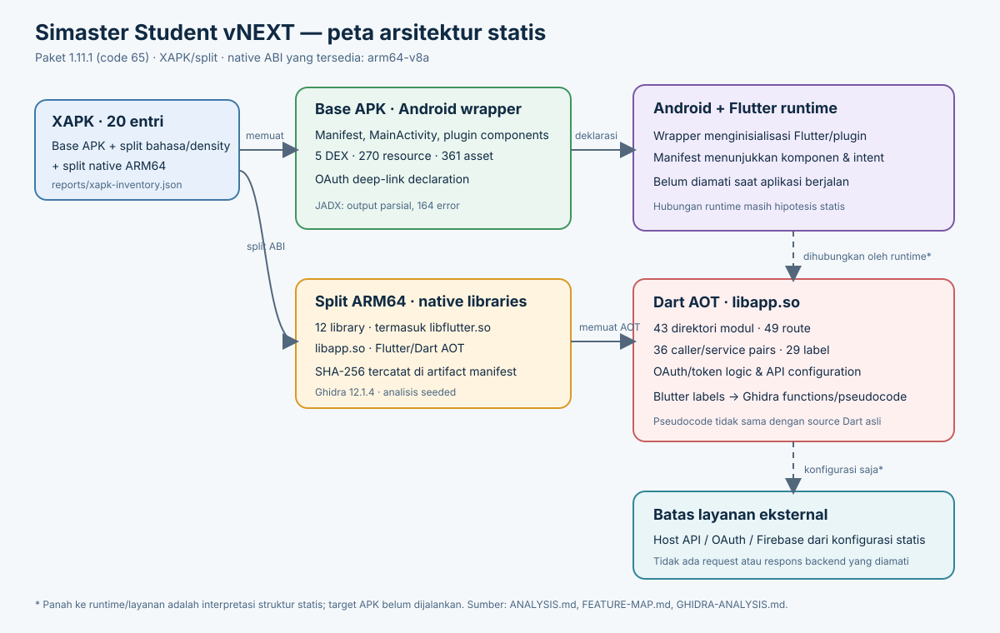

# Simaster UGM Student vNEXT — reverse engineering

Repo privat untuk analisis statis paket Android `id.ac.ugm.student.vnext.simaster` versi **1.11.1 (code 65)**. Analisis berfokus pada inventaris split Android, DEX/resource, Flutter/Dart AOT, hasil Ghidra, dan pemetaan fitur.

> **Status:** baseline analisis tersedia, cakupan belum 100%. APK belum dijalankan; semua route, layanan, dan endpoint di bawah berasal dari artefak statis kecuali bila laporan secara eksplisit menyatakan sebaliknya.

## Arsitektur yang ditemukan

Diagram merangkum jalur paket dan batas layanan yang terlihat dari manifest, inventaris split, string, dan output decompiler. Panah menunjukkan hubungan statis, bukan bukti alur runtime. Detail dan provenance ada di [laporan analisis](reports/ANALYSIS.md).

## Progres analisis

Snapshot baseline untuk target versi 1.11.1:

| Area | Cakupan saat ini | Status |
|---|---:|---|
| Entri APK/split dalam XAPK | 20/20 terinventaris | Inventaris tersedia |
| DEX base APK | 5 DEX; 27.317 class dan 170.057 method tercatat. Fallback JADX menghasilkan 14.749 file, 0 error CLI | Mode auto: 164 error; simple: 67 error. Pemetaan method ke output masih pending |
| Resource JADX | 797 file keluaran | Perlu dicocokkan dengan inventaris resource sumber |
| Flutter AOT / Blutter | 2.312 file assembly, 418 file khusus aplikasi | Parsial; satu assertion di `0xcab944` |
| Fungsi Ghidra | 2.051/2.051 kandidat code function yang ditemukan menghasilkan pseudocode; 50 memiliki caveat indirect jump table | Parsial; function discovery dan code range total belum terbukti |
| Modul | 43 direktori modul ditemukan | Peta nama modul tersedia |
| Route | 49 path dan 49 konstruksi route ditemukan | Binding `/oss_v2` belum dipasangkan |
| Caller/service | 36 pasangan, 29 label service unik | Pemetaan statis |
| Runtime | Belum ada eksekusi aplikasi atau traffic | Belum terverifikasi |

Persentase keseluruhan tidak ditampilkan sebelum denominator per lapisan dapat dibuktikan. Lihat [progress map](reports/PROGRESS.md) untuk status, rumus, bukti, dan langkah berikutnya. “100% inventaris statis” mengikuti [PRD](docs/PRD-REVERSE-ENGINEERING.md); itu tidak berarti source Dart asli pulih identik dari kompilasi AOT.

## Temuan dan laporan

- [Hasil static reverse engineering](reports/ANALYSIS.md) — identitas paket, izin, konfigurasi, metode, provenance, dan batasan.
- [Temuan keamanan statis](reports/SECURITY-FINDINGS.md) — model kredensial presensi, rekonstruksi `_enc`, anomali panjang input, dan kandidat temuan lain; belum divalidasi runtime.
- [PoC offline model kredensial presensi](scripts/presensi_credential_model.py) — derivasi password dan transformasi `_enc` tanpa kode jaringan; contoh output ada di [`reports/presensi-credential-model.example.json`](reports/presensi-credential-model.example.json).
- [Peta route dan service](reports/FEATURE-MAP.md) — route, pengecualian middleware sesi, modul, dan caller/service statis.
- [Analisis Ghidra](reports/GHIDRA-ANALYSIS.md) — metode seeding, alamat, fungsi prioritas, dan keterbatasan.
- [Batch decompile Ghidra](reports/GHIDRA-FULL-DECOMPILE.md) — hasil 2.051 pseudocode, 50 caveat control-flow, dan lokasi output lokal di `/smster`.
- [Pseudocode AOT terpilih](reports/GHIDRA-AOT-SELECTED.md) — lima fungsi yang didecompile dengan Ghidra.
- [Inventaris dan mode decompile DEX](reports/DEX-DECOMPILATION.md) — hitungan per DEX, perbandingan auto/simple/fallback, dan gap pemetaan method.
- [PRD reverse engineering](docs/PRD-REVERSE-ENGINEERING.md) — definisi cakupan, kriteria 100%, kebutuhan CI/CD, dan Definition of Done.
- [`analysis/ghidra/`](analysis/ghidra/) — script seed dan langkah reproduksi Ghidra.
- [`recovered/`](recovered/) — rekonstruksi dan wrapper yang dapat ditinjau; bukan source asli.
- [`reports/`](reports/) — manifest inventaris, hash, dan bukti analisis.

Output JADX/Blutter tersanitasi ada di [`analysis-results.zip`](analysis-results.zip); output JADX fallback ada di [`analysis-results-jadx-fallback.zip`](analysis-results-jadx-fallback.zip). APK/XAPK mentah, DEX, library `.so`, serta database project Ghidra tidak dimasukkan ke repo. Hash dan identitas input dicatat di [`reports/artifact-manifest.json`](reports/artifact-manifest.json).

## Reproduksi

Analisis yang tercatat memakai REA, JADX 1.5.6, Blutter pada commit yang ditautkan di manifest, dan Ghidra 12.1.4. Ikuti instruksi di [README Ghidra](analysis/ghidra/README.md) untuk mengulang analisis headless. Sebelum membandingkan hasil, cocokkan SHA-256 input di manifest. APK tidak otomatis diunduh oleh CI.

## Batas interpretasi

- Hasil JADX parsial: 164 error dan exit code 3.
- Blutter menyelesaikan dump utama tetapi berhenti pada satu assertion.
- Ghidra perlu seed alamat dari output Blutter; angka 2.052 bukan bukti semua fungsi AOT ditemukan.
- Kompilasi Flutter AOT menghilangkan sebagian informasi source. Pseudocode tidak mengembalikan komentar, nama variabel asli, dan seluruh struktur tipe Dart.
- Modul, string, izin, route, dan descriptor API adalah temuan statis. Tanpa eksekusi kompatibel, layar, perilaku, request, dan respons backend tetap belum diketahui.
- Nilai token/API key yang ditemukan pada hasil alat harus disamarkan sebelum perubahan masuk repo.

## CI/CD

[Workflow validasi dan publikasi](https://github.com/gafnaa/simaster-ugm-student-vnext-re/actions/workflows/docs-ci.yml) memeriksa Markdown, tautan lokal, JSON, SVG, pola secret, dan file proprietary pada setiap PR. Setelah merge ke `main`, workflow membuat artifact privat berisi dokumen yang diizinkan saja; artifact disimpan 30 hari. APK tidak diunduh atau dijalankan oleh CI.

## Kontribusi

Setiap perubahan masuk lewat PR dengan satu Conventional Commit per PR, kemudian squash-merge ke `main`. Jalankan `git diff --check` sebelum push dan sertakan sumber/bukti serta dampak ke progress map. Detail kriteria CI/CD dan keamanan ada di PRD.
