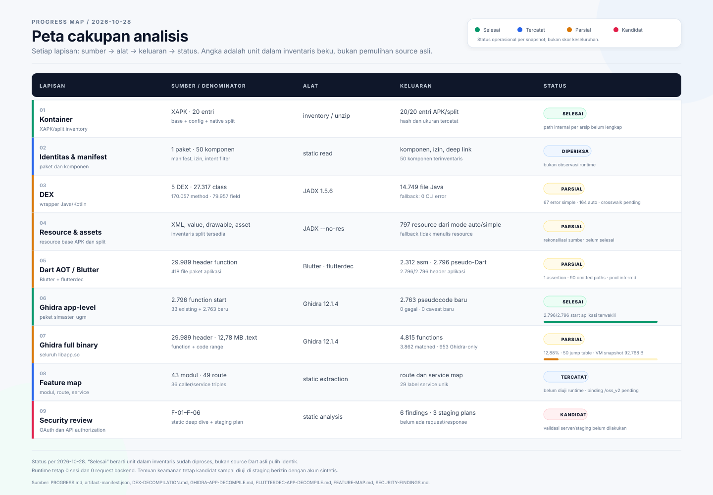

# Progress map — Simaster Student vNEXT

**Snapshot:** 2026-10-28

**Target:** `id.ac.ugm.student.vnext.simaster` 1.11.1 (code 65)  
**Input utama:** `libapp.so` SHA-256 `3d199b5d6983eb7f4f3865c32c1c4e017beecb167e2f7ddac37056bb07ee6290`  
**Makna status:** progres di bawah adalah inventaris baseline yang diketahui, bukan ukuran pemulihan source asli.

## Ringkasan per lapisan

| Lapisan | Denominator / hasil saat ini | Status | Bukti dan gap |
|---|---:|---|---|
| Kontainer XAPK | 20 entri APK/split | Inventaris 20/20 | [`xapk-inventory.json`](xapk-inventory.json); belum ada daftar seluruh path internal tiap arsip di repo. |
| Identitas dan manifest | 1 paket; manifest memuat 50 komponen | Diperiksa statis | [`ANALYSIS.md`](ANALYSIS.md), [`AndroidManifest.xml`](AndroidManifest.xml); bukan observasi runtime. |
| DEX | 5 file; APK Analyzer: 27.317 class, 170.057 method, 79.957 field | Fallback JADX: 14.749 file, 9.707 unit diproses, 0 error CLI; auto 164 error, simple 67 error | Perbedaan 11 class JADX vs APK Analyzer belum direkonsiliasi; crosswalk method-to-output pending. Pencocokan nama top-level awal: 423 class DEX tanpa file Java bernama sama dan 709 file Java tanpa pasangan top-level DEX, sehingga belum boleh disebut 100%. Lihat [`DEX-DECOMPILATION.md`](DEX-DECOMPILATION.md). |
| Resource/assets | Inventaris split tersedia; JADX auto/simple masing-masing menulis 797 resource | Parsial | Fallback dijalankan dengan `--no-res`; rekonsiliasi semua resource/asset sumber ke output belum dilakukan. |
| Native | Split ARM64 mencatat 12 `.so`, termasuk `libapp.so` dan `libflutter.so` | Inventaris ABI tersedia | Belum ada laporan decompile/fungsi per setiap library. Fokus Ghidra saat ini pada `libapp.so`. |
| Dart AOT / Blutter | 2.312 file assembly; 418 file aplikasi; 29.989 alamat function unik | Parsial | Satu assertion pada `0xcab944`; denominator function/range AOT belum dikonfirmasi secara independen. |
| Ghidra `libapp.so` | 4.815 function entries; 2.796/2.796 function start aplikasi terwakili; 2.763 pseudocode baru bersih; 0 gagal; 0 caveat baru | App-level selesai; full binary parsial | Full AOT: 3.862/29.989 function (12,88%); non-aplikasi 1.066/27.193 (3,92%); 953 function Ghidra-only; 281 body-size mismatch; 50 indirect jump table baseline; object VM snapshot 92.768 byte belum dipetakan. Output lokal: `/smster/work/ghidra/decompiled-app-2026-10-27`. Lihat [`GHIDRA-APP-DECOMPILE.md`](GHIDRA-APP-DECOMPILE.md). |
| Flutterdec app-level | 2.796/2.796 header function aplikasi setelah augmentasi owner top-level; canonical 2.628 record | Cakupan alamat app-level lengkap; pseudo-Dart parsial | Run canonical: 2.628 record, 12 placeholder `if`, 8,28% indirect call. Run augmented: 2.796 record, 15 placeholder `if`, 8,93% indirect call, 90 penanda jalur hilang, 1.943 instruksi tidak terangkat; 168 function top-level direkonsiliasi. Output lokal: `/var/smster/work/flutterdec-2026-10-28/app-simaster_ugm-toplevel`. Lihat [`FLUTTERDEC-APP-DECOMPILE.md`](FLUTTERDEC-APP-DECOMPILE.md). |
| Backend r2flutter | 42.809 entri instruction table; 2.748/2.796 start aplikasi sama persis; 67.048/67.440 slot pool identik | Evaluasi selesai; pembanding, bukan pengganti | 48 header sisanya mulai +0x18 (thunk `dyn:`/getter); ukuran body 2.747/2.748 cocok. Nama metode 100% pada 1.160 header yang dapat diparse setelah normalisasi konvensi; owner 98,02%. Tidak ada atribusi package/superclass. Output lokal: `/var/smster/work/r2flutter-2026-10-29`. Lihat [`R2FLUTTER-BACKEND-EVALUATION.md`](R2FLUTTER-BACKEND-EVALUATION.md). |
| Modul aplikasi | 43 direktori modul teridentifikasi | Pemetaan nama tersedia | Belum ada pemetaan lengkap setiap class/function ke modul dan alur layar. |
| Route | 49 literal path dan 49 konstruksi `GetPage` | 49/49 tercatat | Binding `/oss_v2` belum dipasangkan; belum diuji runtime. |
| Middleware sesi | 18 nama pengecualian ditemukan | 18/18 nama tercatat | Interpretasi berasal dari list statis dan tidak menunjukkan route mana yang benar-benar tercapai. |
| Caller/API service | 36 caller/method/service triples, 29 label unik | 36/36 triples yang dipulihkan tercatat | Tidak membuktikan request terkirim. Path beberapa layanan dirakit saat runtime dan perlu ditelusuri. |
| Endpoint inventory | 8 URL production + 2 URL OAuth dev; 29 label; 28 operasi gateway + 1 lookup langsung | Konsolidasi statis; 0 request | [`API-ENDPOINT-INVENTORY.md`](API-ENDPOINT-INVENTORY.md); jumlah ini mencakup bukti yang sudah didokumentasikan, bukan seluruh permukaan backend. |
| Perilaku runtime | 0 sesi aplikasi; 0 request backend diamati | Belum diketahui | Emulator x86_64 tidak mendukung split ARM64 target dalam konfigurasi yang dicoba; lihat `ANALYSIS.md`. |
| Keamanan statis | 4 deep dive (F-01, F-02, F-05, F-06) + 2 kandidat ringkas (F-03–F-04) | Kandidat; belum divalidasi runtime/server | [`SECURITY-FINDINGS.md`](SECURITY-FINDINGS.md), [`OAUTH-DEEP-DIVE.md`](OAUTH-DEEP-DIVE.md), [`API-AUTH-DEEP-DIVE.md`](API-AUTH-DEEP-DIVE.md); model presensi/PoC offline dan rencana uji staging, tanpa uji produksi. |

## Peta cakupan

Diagram merangkum hubungan sumber, alat, keluaran, dan status untuk setiap lapisan. Warna status menunjukkan tingkat penyelesaian operasional, bukan skor keamanan atau kualitas source hasil rekonstruksi.

## Cara membaca cakupan

- `N/N tercatat` hanya mengukur unit dalam daftar yang telah diekstrak. Itu belum membuktikan tidak ada unit yang terlewat oleh ekstraktor.
- Persentase decompile DEX belum ditampilkan karena denominator class/method dan crosswalk antaralat belum dibekukan. Persentase AOT di atas memakai denominator 29.989 alamat function Blutter dan hanya mengukur function start yang punya padanan Ghidra, bukan seluruh byte atau semantik source.
- Lima fungsi Ghidra dengan pseudocode adalah sampel prioritas, bukan klaim 5 dari total 2.052 sudah selesai; angka 2.052 adalah fungsi yang ditemukan setelah lima seed. Setelah batch aplikasi, Function Manager berisi 4.815 fungsi dan seluruh function start paket `simaster_ugm` sudah terwakili, tetapi function non-aplikasi dan code range lain belum selesai.
- Flutterdec canonical memilih 2.628 record; 168 header Blutter yang tersisa seluruhnya berada di blok top-level `class ::` tanpa owner class. Augmentasi owner sintetis menghasilkan 2.796/2.796 record, tetapi angka itu adalah cakupan alamat function aplikasi, bukan cakupan semantik seluruh 29.989 function AOT. Nama `__TopLevel_*` bukan class Dart asli.
- Target 100% yang diterima harus mengikuti kriteria dan status unit pada [PRD](../docs/PRD-REVERSE-ENGINEERING.md). Source Dart yang hilang akibat kompilasi AOT tetap menjadi batas teknis.

## Next actions

1. Ekstrak inventaris per file XAPK/APK termasuk path internal, ukuran, hash, ABI, DEX, resource, dan assets.
2. Buat crosswalk 170.057 method DEX ke hasil fallback, lalu triase 67 error simple dan 164 error auto per method.
3. Bangun inventaris resource yang membedakan XML/value, drawable, asset binary, dan file yang tidak dapat didekode.
4. Seed/klasifikasikan 27.193 function non-aplikasi atau dokumentasikan batas fokus security; triase 953 function Ghidra-only dan 281 body-size mismatch.
5. Tindak lanjuti evaluasi backend `r2flutter`: triase 48 header dengan batas +0x18, 9 slot pool residual, dan 23 atribusi `_enumToString`; pertahankan augmentasi owner top-level sebagai workaround lokal, bukan klaim class Dart asli. Lihat [`R2FLUTTER-BACKEND-EVALUATION.md`](R2FLUTTER-BACKEND-EVALUATION.md).
6. Triase 50 indirect jump table Ghidra, petakan `_kDartVmSnapshotInstructions`, lalu bandingkan seluruh output Blutter dengan code range executable dan byte yang belum terklasifikasi.
7. Petakan library native relevan lain (12 `.so`) atau dokumentasikan alasan tidak dianalisis.
8. Tambahkan provenance per temuan dan tandai status runtime hanya setelah ada eksekusi yang kompatibel dan berizin.
9. Setelah izin UGM tersedia, jalankan [`OAUTH-STAGING-TEST-PLAN.md`](OAUTH-STAGING-TEST-PLAN.md) untuk memvalidasi F-02.1–F-02.8; jangan memakai produksi atau akun nyata.
10. Setelah token staging dan audit server tersedia, jalankan [`API-AUTH-STAGING-TEST-PLAN.md`](API-AUTH-STAGING-TEST-PLAN.md) untuk F-05/F-06 (A-01–A-13); hentikan bila data nyata atau host production muncul.

## Referensi baseline

- [Analisis umum](ANALYSIS.md)
- [Feature map](FEATURE-MAP.md)
- [Inventaris endpoint dan operasi gateway](API-ENDPOINT-INVENTORY.md)
- [Analisis Ghidra](GHIDRA-ANALYSIS.md)
- [Decompile AOT paket aplikasi](GHIDRA-APP-DECOMPILE.md)
- [Decompile Flutterdec paket aplikasi](FLUTTERDEC-APP-DECOMPILE.md)
- [Evaluasi backend r2flutter](R2FLUTTER-BACKEND-EVALUATION.md)
- [Pseudocode Ghidra terpilih](GHIDRA-AOT-SELECTED.md)
- [Temuan keamanan statis](SECURITY-FINDINGS.md)
- [OAuth deep dive](OAUTH-DEEP-DIVE.md)
- [Rencana uji OAuth staging](OAUTH-STAGING-TEST-PLAN.md)
- [API authorization deep dive](API-AUTH-DEEP-DIVE.md)
- [Rencana uji API staging](API-AUTH-STAGING-TEST-PLAN.md)
- [Manifest artifact dan tool](artifact-manifest.json)
